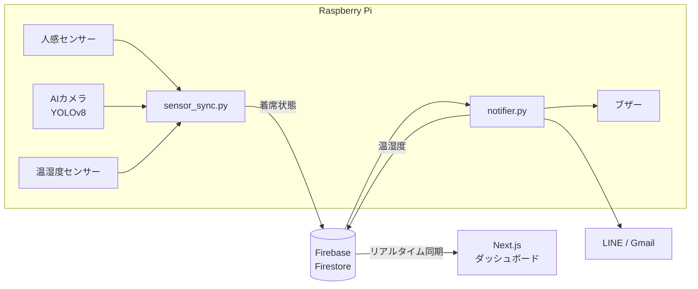

# VITAL FLOW

着席時間と睡眠時間から**疲労スコア**を出し、疲れがたまる前に休憩をうながすダッシュボードです。
職業訓練校（AI・IoT 科）の卒業制作として、Raspberry Pi のセンサーと Web 画面をつないで作りました。

**デモ**：https://pereperia.github.io/vital-flow/
（センサーなしで動くデモ版です。「座る／席を立つ」ボタンでセンサーの代わりに操作でき、1秒を1分として時間が進みます）

---

## 作ったきっかけ（課題）

- 集中していると、何時間も座りっぱなしになっていることに気づけない
- 寝不足の日は、いつもより早く疲れているのに、無理をして続けてしまう
- 室温や湿度が上がっていても、作業中は気づきにくい

## どう解決したか

| 課題 | 解決 |
|---|---|
| 座りっぱなしに気づけない | 人感センサーで着席を検知し、着席時間を画面にリアルタイム表示 |
| 寝不足でも無理をする | 睡眠不足と着席時間から疲労スコアを計算し、65% を超えたら休憩をうながす |
| 環境の変化に気づかない | 温湿度を測り、高温多湿（28℃以上かつ 65%以上）で警告 |
| 画面を見ていないと気づけない | LINE・Gmail・ブザーでも通知 |

## 疲労スコアの考え方

```
疲労スコア = 睡眠不足（時間）× 15 ＋ 着席時間（分）÷ 90 × 50 − 休憩ボーナス
```

- 理想の睡眠は 20代 8時間、30代以上 7時間
- 90分座り続けると 50点
- 水分補給で −10、ストレッチで −20
- 席を立っている間は、1分ごとに 2点ずつ回復

## 構成



| 区分 | 使用技術 |
|---|---|
| 画面 | Next.js（App Router）、TypeScript、Tailwind CSS、Recharts |
| クラウド | Firebase（Cloud Firestore）のリアルタイム同期 |
| 機器側 | Raspberry Pi、Python、人感センサー（PIR）、DHT11、YOLOv8、SQLite |
| 通知 | LINE Messaging API、Gmail（SMTP）、ブザー（GPIO） |

## 工夫した点

- **センサーの誤判定を AI カメラで補う**：人感センサーは、じっと座っていると反応しなくなる。30秒反応がないときだけカメラで人を確認し、「集中しているのに離席扱い」になるのを防いだ
- **通信を必要なときだけにする**：着席状態は変わったとき（と 3秒ごとの生存確認）、温湿度は値が変わったときだけ送る
- **通知が続きすぎないようにする**：同じ通知は 30分あける
- **センサーなしでも見せられるようにする**：発表用に、ボタンで着席・離席を切り替え、時間を早送りできるデモモードを用意した

## 公開にあたって整理した点

当時のコードには鍵やトークンが直接書かれていたため、公開用に作り直しました。

- 鍵・トークン・パスワードはすべて環境変数から読み込む形にした（リポジトリには含めない）
- Firebase の設定がないときは、センサーなしのデモとして動くようにした
- ラズパイは 3秒ごとに同じ状態を送り直すため、そのたびに着席時間がリセットされないよう、**状態が変わったときだけ**開始時刻を更新するようにした
- LINE と Gmail が 1つのクールダウン用の変数を共有していて、Gmail を送った直後の LINE が送られなかったため、通知の種類ごとに分けた
- 日付を UTC で作っていたため、日本時間ではグラフの日付が 1日ずれることがあった。端末の現地時刻で作るようにした
- グラフの履歴は見本データ（実機の記録ではない）

## ディレクトリ構成

```
app/                  ページ（Next.js App Router）
components/
└── Dashboard.tsx     ダッシュボード画面
lib/
├── fatigue.ts        疲労スコアの計算
├── history.ts        グラフ用の見本データ
└── firebaseSource.ts Firestore の監視
raspi/
├── sensor_sync.py    着席判定（人感センサー＋AIカメラ）と Firebase 送信
└── notifier.py       疲労スコア・環境の判定と通知
scripts/
└── logic.test.ts     計算部分のテスト
```

## 動かし方

```bash
npm install
npm run dev        # http://localhost:3000
npm run test:logic # 計算部分のテスト（Node.js 22 以上）
```

Firebase とつなぐ場合は、`.env.example` を `.env.local` にコピーして値を入れます。
ラズパイ側は `raspi/requirements.txt` を入れ、`FIREBASE_KEY_PATH` などの環境変数を設定して実行します（実機とセンサーが必要です）。

## 開発の進め方と AI の活用について

- 当時は StackBlitz 上で開発し、生成 AI（Gemini）に機能の追加やエラーの原因を相談しながら作りました
- この公開版は、当時のコードをもとに、生成 AI（Claude）を使って再構成しています
